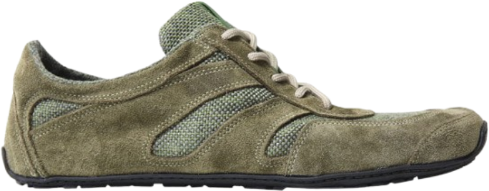

> Are barefoot shoes genuinely beneficial or a commercial hype product that can cause harm?

Half a year ago, in early April, I bought my first pair of barefoot shoes. I was drawn in by the idea of improving my foot health, especially my toe splay which was quite damaged from wearing undersized Nike Dunks from Ebay for a couple years during college.
These were a green pair of [Tadeevo's Ease trainers](https://tadeevo.com/en_GB/p/Ease-green-barefoot-shoes-Tadeevo/130) made from a combination of suede and a breathable fabric, with a [stack height of 5mm](https://anyasreviews.com/tadeevo-minimalist-review/) (assuming similar construction to Tadeevo Bliss reviewed by [Anya's Reviews](https://anyasreviews.com)).

{: width="260" }
*Tadeevo Ease Green Variant*

Prior to their arrival, I researched the transition process and found a few repeated snippets of advice:
- Start slowly. 
  Begin with around 10 minutes per day and gradually increase.
- If you have pain that does not go away by the next day, then rest and return once it is gone.
- Poor form can cause pain. In the case of localised pain, feel your body carefully and adjust until it stops.
  This may include responding to heel pain by landing with your feet beneath you rather in front.
  
*Note: While using data from your body can be useful, please also use common sense. If you can't explain why you are making an adjustment, you may just need a break and adjusting your form will not help.*

## First impression

When the shoes first arrived from Poland I took them on a 10-minute expedition of the area around my flat.
Although used to walking barefoot indoors, feeling the previously forbidden outdoor ground I'd covered so often in my thick-soled trainers was new and exciting.
So much so, that after my short walk, I was already fighting the infectious ideas of barefoot-dom and internet evangelism. 
However, steeling myself, I considered the other thing I'd noticed: that my shoes were too long, and I'd probably ordered the wrong size.

## Customer service rant

Tadeevo have the following policy for returns:
> "your item must be in a clean and resalable condition, unworn without any visible signs of use" ([30-day Money Back Guarantee](https://tadeevo.com/en_US/i/30-Day-Money-Back-Guarantee/21))

After returning from my walk, I emailed customer service sharing photos of the shoe's condition and my request to exchange them for a smaller pair. Somehow, during my short walk, the logo on the leather insole had worn away enough that Tadeevo deemed my shoes to 'show signs of outdoor wear', I was told I was ineligible for a return.

So, to make the most of it, I continued wearing these shoes for a few more months before replacing them with [another pair](https://www.barebarics.com/barefoot-sneakers-barebarics-dropsta-black/) which I have been wearing up until now.

## Unsubstantiated promises

Throughout their introduction into the commercial market, barefoot shoes have been promised to bring many benefits to those who do not yet wear them. For example Vivobarefoot (a prominent barefoot brand) claims to bring its customers
1. Stronger feet
2. Better balance
3. More skilful movement
4. Improved posture
5. Fewer injuries and health problems
 ([Vivobarefoot: Embrace Barefoot Living](https://www.vivobarefoot.com/uk/blog/benefits-of-barefoot-shoes)) 

The lack of sources on their page had me suspicious so I looked for some studies that could back up these statements. There a lot of small studies with sample counts ranging from 15 to 213 participants in [one of larger studies I found](https://www.mdpi.com/2077-0383/14/21/7629).

## Familial warning

After buying my shoes I started to hear negative aniquedotes from those around me. Including my parents who told me of their coworker who jumped into Vivobarefoot, did not start slow and had various foot issues. 

They also told me of storeis from their friends who, during Covid, had been walking more frequently on hard indoor floors barefoot. These people reportedly were caused plantar fascietis (flat feet) - was this due to the too fast entrance to barefoot? Or was it the case that they had it for a while and going barefoot a lot with not slow introduction made them realise so.

> NOte ot cole: cross cmopare these stories to findings from research papers findinds about the benfefits./disadvantages of barefoot shoes.
> Think about what do they align with and contradict - are they explainable without contradicting research - or are both being true mutually exclusive
> Are the issues that they faced completely unrelated to barefoot shoes?

## My experience
I slowly introduced myself into barefoot shoes 

RLS not affected (made no better nor worse) from barefoot shoes

Positives:
* thing

Negatives:
* thing

No change:
* thing

compare my conclusions from my experience to parents aniquedotes and to research papers.

## Conclusion

> Summarise my answer to: Are barefoot shoes genuinely beneficial or a the a commercial hype product that can potentially cause harm?
> Outline my key points
> Areas for further research / remaining unanswered questions
> Barefoot running in future.